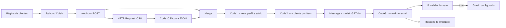
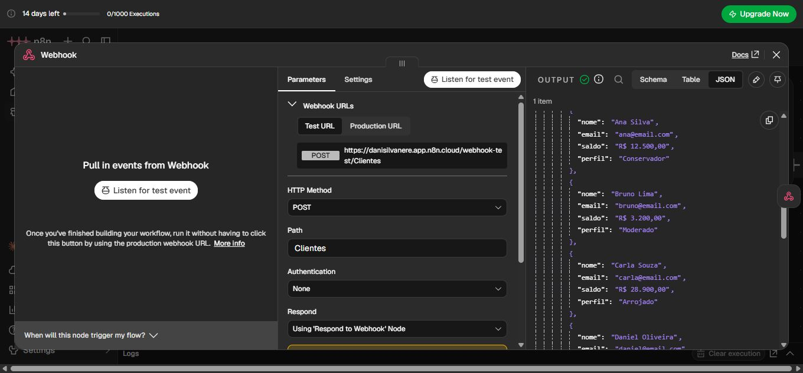
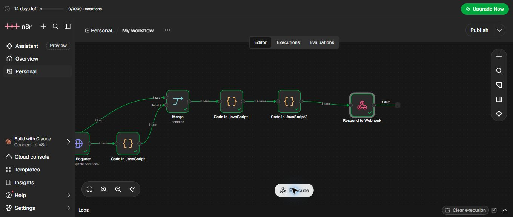
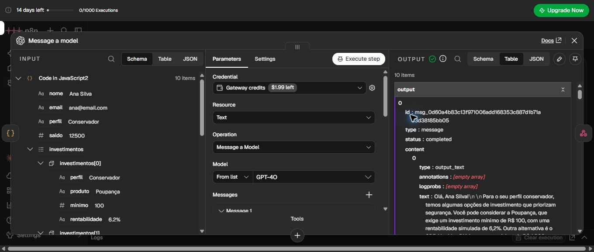
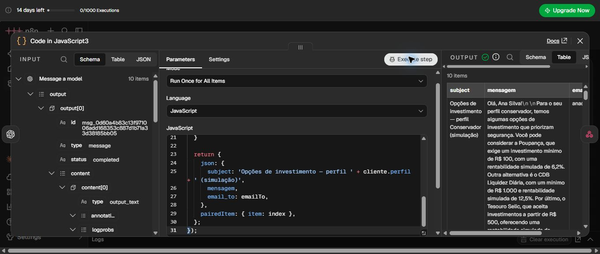
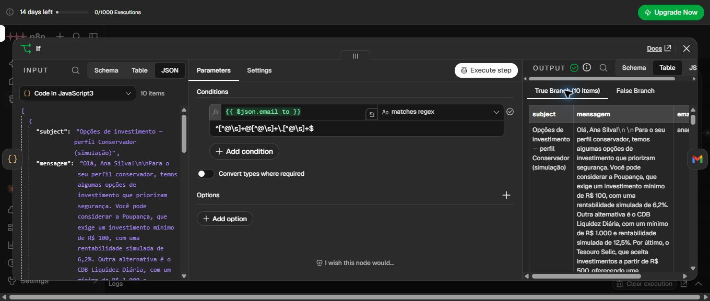
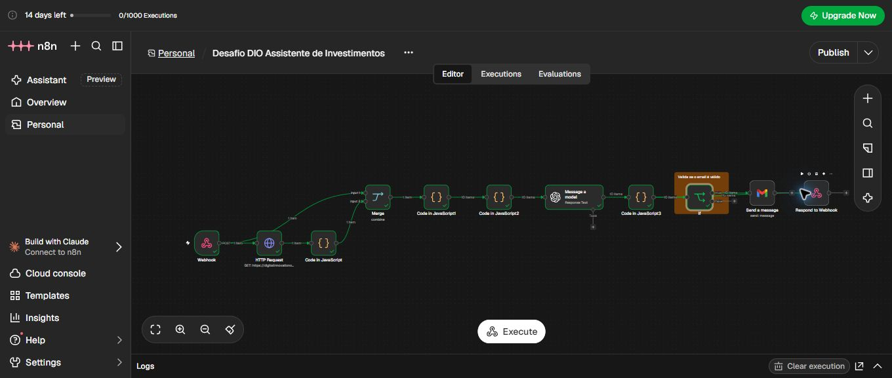
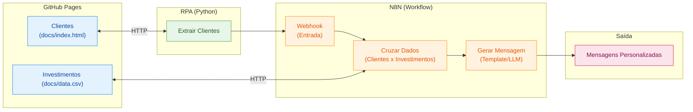

# Assistente de Investimentos com RPA e IA Generativa

Projeto desenvolvido por **Danielle Nere** para o desafio da DIO. Integra extração de dados com Python, orquestração no n8n e geração de mensagens personalizadas com um LLM.

> Os clientes, saldos e investimentos pertencem a uma base simulada e são utilizados para fins educacionais. As taxas da base não representam uma consulta ao mercado.

## Implementação e resultado

O Python coleta os clientes de uma página HTML e envia a lista ao Webhook do n8n. O workflow lê o CSV de investimentos, cruza o perfil do cliente com os produtos da base e verifica se o saldo atende ao mínimo de aplicação de cada opção. Em seguida, gera uma mensagem estática e, na versão com IA, produz um novo texto personalizado.

**Foram validados 10 clientes na geração com IA e na normalização dos campos para email.** O nó Gmail está configurado, mas o envio e a entrega de emails ainda não foram testados. A resposta ao Colab contém os resultados gerados; ela não confirma o envio pelo Gmail.

### Arquivos do projeto

- [Notebook de extração e envio ao Webhook](rpa/extrair_clientes.ipynb)
- [Workflow exportado do n8n](Desafio%20DIO%20Assistente%20de%20Investimentos.json)
- [Página de clientes](docs/index.html)
- [Base de investimentos](docs/data.csv)
- [Prints do processo](evidencias/)

O workflow foi salvo na raiz com o nome exportado pelo n8n. Esse é o JSON a ser importado para reproduzir a implementação.

## Arquitetura implementada



A saída falsa do If não envia emails. A validação por expressão regular verifica apenas o formato do endereço: ela não verifica a existência da caixa postal.

### Responsabilidade de cada nó

| Nó | Função |
|---|---|
| Webhook | Receber por POST o objeto com a lista `clientes`. |
| HTTP Request | Consultar o CSV de investimentos do projeto base. |
| Code in JavaScript | Converter o CSV para a lista `investimentos` e normalizar os valores mínimos. |
| Merge | Reunir o objeto recebido pelo Webhook e a lista de investimentos. |
| Code in JavaScript1 | Converter saldos, filtrar produtos por perfil e mínimo acessível e gerar o texto estático do MVP. |
| Code in JavaScript2 | Entregar um cliente por item à IA, preservando o vínculo entre os itens. |
| Message a model | Gerar o texto dinâmico com GPT-4o usando os dados do cliente e as opções já filtradas. |
| Code in JavaScript3 | Extrair o texto da IA e produzir `subject`, `mensagem` e `email_to`. |
| If | Conferir o formato de `email_to` antes do Gmail. |
| Send a message | Usar os campos normalizados no Gmail, com corpo em texto. Envio ainda não validado. |
| Respond to Webhook | Retornar ao chamador um objeto com `total` e `mensagens`. |

## Registro do processo com evidências

Os prints abaixo documentam a evolução da implementação. As capturas do MVP são de uma etapa anterior à inclusão da IA e do Gmail; a última imagem mostra a configuração revisada.

### 1. Extração e recebimento no Webhook

O notebook extraiu os clientes fictícios e enviou a lista com `requests.post(..., json={"clientes": clientes})`. O Webhook recebeu os 10 clientes em `body.clientes`. Nesse estágio, o Colab recebeu status HTTP 200.

Foi necessário ativar o trecho de envio que estava comentado no notebook. A extração, sozinha, mostrava os clientes no Colab sem enviá-los ao n8n.



### 2. MVP com mensagens estáticas

A primeira versão cruzou os clientes com os investimentos e retornou mensagens estáticas ao Colab. Nesse teste, a resposta continha `total: 10` e as mensagens.

O filtro considera o perfil e o mínimo de cada produto individualmente. Por exemplo, Bruno possui R$ 3.200,00: uma opção com mínimo de R$ 5.000,00 não entra na sua lista. A lista não representa uma alocação simultânea do saldo em todos os produtos.



### 3. Mensagens dinâmicas com IA

Foi incluído o nó **Message a model**, com GPT-4o. O prompt recebe nome, perfil, saldo e investimentos filtrados e orienta a produzir uma mensagem em português, sem inventar produtos ou prometer resultados.

Na primeira tentativa, os clientes estavam agrupados em `mensagens`, enquanto o prompt buscava os campos diretamente em `$json`. A correção foi fornecer um cliente por item. Após esse ajuste, o nó gerou **10 respostas personalizadas**.

A implementação utiliza uma chamada direta ao modelo pelo nó Message a model; não utiliza o nó AI Agent com ferramentas.



### 4. Normalização para email

O Code3 extrai o conteúdo `output_text` da resposta do modelo e recupera o destinatário do cliente vinculado. O resultado é um item por cliente com os campos:

```json
{
  "subject": "Opções de investimento — perfil Conservador (simulação)",
  "mensagem": "Texto personalizado gerado pela IA.",
  "email_to": "ana@email.com"
}
```

O exemplo acima ilustra o formato; o texto efetivo varia por cliente. A normalização também remove marcadores de negrito do texto e rejeita mensagens vazias ou endereços com formato inválido.



### 5. Validação do formato do email

O If inicialmente consultava `to`, mas o campo produzido pelo Code3 é `email_to`. A expressão foi corrigida para `{{ $json.email_to }}` e testada com a expressão regular:

```text
^[^@\s]+@[^@\s]+\.[^@\s]+$
```

Após a correção, **10 itens passaram para a saída verdadeira**. Esse teste executou apenas o If e não enviou emails.



### 6. Workflow revisado

A configuração final contém a geração por IA, a normalização, a condição de formato de email e o Gmail configurado. O Respond to Webhook foi reconectado à saída do Code3, em uma ramificação que devolve os dados normalizados ao Colab.



### O que foi validado

| Etapa | Resultado observado |
|---|---|
| Extração dos clientes | 10 clientes fictícios extraídos. |
| Colab → Webhook | Lista recebida em `body.clientes`; HTTP 200 no teste inicial. |
| MVP estático | Resposta ao Colab com 10 mensagens. |
| Leitura e cruzamento do CSV | Produtos filtrados por perfil e mínimo acessível. |
| Geração dinâmica | 10 respostas produzidas pelo modelo. |
| Normalização | 10 itens com `subject`, `mensagem` e `email_to`. |
| If corrigido | 10 itens na saída verdadeira do teste de formato. |
| Gmail | Campos e formato de texto configurados; envio e entrega não testados. |
| Resposta final com IA | Estrutura configurada para retornar os itens normalizados; não foi executado um novo teste completo com Gmail após a revisão final. |

## Como reproduzir

1. Importe no n8n o [JSON do workflow](Desafio%20DIO%20Assistente%20de%20Investimentos.json).
2. Configure suas próprias credenciais para o modelo e, caso utilize o envio, para o Gmail. As referências de credenciais do autor não concedem acesso às contas.
3. Abra o [notebook](rpa/extrair_clientes.ipynb) no Colab e execute a instalação de `requests` e `beautifulsoup4`.
4. Copie a URL de teste do seu Webhook e substitua o valor de `N8N_WEBHOOK` no notebook. O endereço salvo é específico da instância utilizada no desenvolvimento.
5. Para reproduzir a geração sem envio externo, desative o nó Gmail antes de executar o fluxo completo.
6. No n8n, clique em **Execute workflow** para aguardar a chamada de teste. Execute então a célula de extração e envio no Colab.
7. Confira os resultados nos nós e na resposta do Colab. A geração de 10 mensagens pode ultrapassar os 30 segundos configurados no notebook; nesse caso, ajuste o tempo de espera da requisição conforme a duração observada.
8. Para demonstrar o Gmail, use um endereço de teste sob seu controle e execute com apenas um cliente. Os endereços da base são fictícios. O recebimento desse email é uma validação adicional ainda pendente.

### Mapeamento do Gmail

| Campo | Valor |
|---|---|
| To | `{{ $json.email_to }}` |
| Subject | `{{ $json.subject }}` |
| Message | `{{ $json.mensagem }}` |
| Email Type | Text |

### Decisões técnicas e limites

- O cruzamento usa regras explícitas de perfil e saldo antes de chamar o modelo.
- O modelo é responsável pela redação, enquanto o código seleciona as opções da base.
- O vínculo dos itens é preservado para associar o texto da IA ao destinatário correto.
- A resposta ao Colab é independente do envio pelo Gmail: HTTP 200 não comprova entrega de email.
- O leitor de CSV usa separação simples por vírgula, adequada à base utilizada. Um CSV com vírgulas dentro de campos entre aspas exige um leitor que interprete esse formato.
- As mensagens geradas por IA devem ser revisadas. O prompt restringe a resposta aos dados simulados, mas não garante o cumprimento de todas as instruções em toda execução.
- O teste de email confere sintaxe e não confirma existência, titularidade ou capacidade de receber mensagens.
- O processo foi validado por etapas. As evidências não comprovam um envio de email nem uma execução completa da versão final com Gmail.

## Créditos

Desenvolvido por **Danielle Nere**, a partir do desafio [DIO — Assistente de Investimentos com RPA e n8n](https://github.com/digitalinnovationone/dio-lab-assistente-investimentos-rpa-n8n).

---

<details>
<summary>Enunciado e roteiro original do desafio</summary>

## Criando um Assistente de Investimentos com RPA e IA Generativa

## Descrição

Aprenda na prática como criar um fluxo de automação inteligente combinando técnicas de RPA (Robotic Process Automation) com workflows de IA no N8N.

Neste desafio, você vai construir um assistente de investimentos automatizado. O fluxo começa com a extração de dados de clientes em uma página web usando Python, passa pela orquestração de um workflow no N8N e termina com a geração de mensagens personalizadas para cada perfil de investidor.

O projeto foi pensado para ser simples e acessível, mesmo para quem está dando os primeiros passos em Python e automação. A ideia é que você entenda o conceito de RPA de forma leve e aplique tudo em um cenário realista do mercado financeiro.

## Objetivo do Projeto

Desenvolver um pipeline de automação que:

1. **Coleta dados de clientes** de uma página web simulada usando Python
2. **Processa as informações** através de um workflow no N8N
3. **Cruza perfis de investidor** com uma base de opções de investimento
4. **Gera mensagens personalizadas** para cada cliente

Ao final, você terá um sistema funcional que demonstra como empresas do setor financeiro podem automatizar a comunicação com clientes de forma inteligente.

## Arquitetura do Projeto



## Tecnologias e Ferramentas

O projeto utiliza ferramentas gratuitas e acessíveis, organizadas conforme cada etapa do fluxo:

| Etapa | Ferramenta | Função |
|-------|-----------|--------|
| Hospedagem | GitHub Pages | Servir a página de clientes e o CSV de investimentos |
| Extração (RPA) | Python + BeautifulSoup | Coletar dados dos clientes via web scraping |
| Orquestração | N8N | Processar dados, cruzar perfis e gerar mensagens |
| Geração com IA | Agente de IA no N8N | Criar mensagens personalizadas com LLM (desafio extra) |

Além dessas, você pode usar IAs generativas como **Gemini**, **Claude** ou **ChatGPT** como copilotos para auxiliar na escrita de código e tirar dúvidas ao longo do desenvolvimento.

## Roteiro do Desafio

### Etapa 1: Entenda o Projeto

Antes de começar, explore o repositório base que já contém a estrutura inicial:

1. **Página de Clientes (`docs/index.html`):** Uma página HTML hospedada no GitHub Pages com uma lista de clientes fictícios contendo nome, email, saldo e perfil de investidor (Conservador, Moderado ou Arrojado). Disponível online [neste link](https://digitalinnovationone.github.io/dio-lab-assistente-investimentos-rpa-n8n).
2. **Dados de Investimentos (`docs/data.csv`):** Um arquivo CSV também hospedado no GitHub Pages com opções de investimento organizadas por perfil. Disponível online [neste link](https://digitalinnovationone.github.io/dio-lab-assistente-investimentos-rpa-n8n/data.csv).
3. **Script de RPA (`src/extrair_clientes.ipynb`):** Um notebook Python que acessa a página de clientes e extrai os dados da tabela usando BeautifulSoup.

> 🤖 **Por que o script é considerado RPA?** Ele faz exatamente o que um humano faria manualmente: abre uma página, lê os dados de uma tabela e os envia para outro sistema. A diferença é que o "robô" (código) executa isso automaticamente. Essa abordagem é útil quando não existe uma API disponível ou quando precisamos integrar sistemas legados.

### Etapa 2: Configure o Ambiente

1. Faça um **fork** do repositório base para sua conta do GitHub
2. Crie uma conta no [N8N Cloud](https://n8n.io/) ou instale localmente
3. Abra o notebook `src/extrair_clientes.ipynb` no [Google Colab](https://colab.research.google.com/) e execute para entender o fluxo de extração

> 💡 **Atenção:** O script já extrai os dados, mas o envio ao N8N está comentado (`TODO`). Você vai configurar a URL do Webhook após criá-lo na próxima etapa.

### Etapa 3: Desenvolva o Workflow no N8N

Este é o coração do desafio! Monte um fluxo que:

1. Receba os dados dos clientes via Webhook (copie a URL gerada e configure no script Python)
2. Leia o arquivo `docs/data.csv` com as opções de investimento
3. Cruze o perfil de cada cliente com a opção adequada
4. Gere uma mensagem de recomendação para cada cliente

### Etapa 4 (MVP): Mensagens Estáticas

Para a versão mínima, use templates de mensagem fixos baseados no perfil:

- **Conservador:** Foco em renda fixa e segurança
- **Moderado:** Mix equilibrado entre renda fixa e variável
- **Arrojado:** Ênfase em ações e maior potencial de retorno

### Etapa 5 (Desafio): Integração com IA Generativa

Conecte o Agente de IA do N8N a um modelo como Gemini ou GPT para:

- Analisar o contexto do cliente (saldo, perfil)
- Gerar mensagens únicas e personalizadas
- Criar recomendações mais inteligentes e humanizadas

## Entregáveis

### MVP (Mínimo Viável)

- [ ] Repositório forkado com o workflow N8N implementado
- [ ] Workflow N8N exportado (`n8n/workflow.json`) com mensagens estáticas
- [ ] Script de RPA integrado ao Webhook do N8N
- [ ] Print ou vídeo demonstrando o fluxo funcionando de ponta a ponta

### Desafio Completo

- [ ] Todos os itens do MVP
- [ ] Integração com Agente de IA no N8N
- [ ] Mensagens geradas dinamicamente via LLM
- [ ] Documentação explicando as decisões técnicas

## Estrutura do Repositório

```
📁 dio-lab-assistente-investimentos-rpa-n8n/
├── 📄 README.md
├── 📁 src/
│   └── 📄 extrair_clientes.ipynb   # ✅ Notebook Python (já implementado, falta só o TODO)
├── 📁 n8n/
│   └── 📄 workflow.json            # 🎯 Seu desafio: exportar o workflow aqui
└── 📁 docs/
    ├── 📄 index.html               # ✅ Página de clientes (já implementado)
    └── 📄 data.csv                 # ✅ Opções de investimento (já implementado)
```

## Prompts Úteis para Copilotos de IA

| Tarefa | Sugestão de Prompt |
|--------|-------------------|
| Gerar dados fictícios | "Crie 10 clientes fictícios com nome, email, saldo e perfil de investidor em JSON" |
| Entender código | "Explique o que faz a biblioteca BeautifulSoup em Python" |
| Debugar erros | "Meu script Python está dando erro X, o que pode ser?" |
| Montar workflow | "Como configuro um webhook no N8N para receber dados JSON?" |

## Referências

- [Documentação do N8N](https://docs.n8n.io/)
- [BeautifulSoup: Web Scraping com Python](https://realpython.com/beautiful-soup-web-scraper-python/)
- [GitHub Pages: Guia Rápido](https://pages.github.com/)

---

**Bons estudos e mãos à obra** 🚀

Se tiver dúvidas, lembre-se: a melhor forma de aprender é experimentando. Erre, corrija e celebre cada pequena vitória no caminho.

</details>

